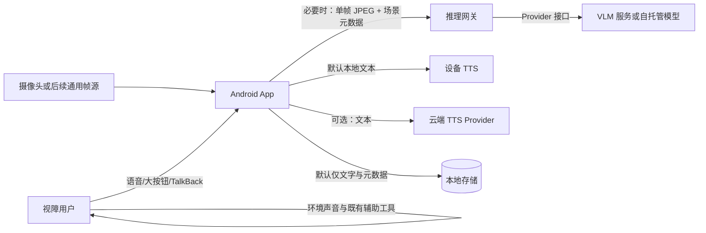
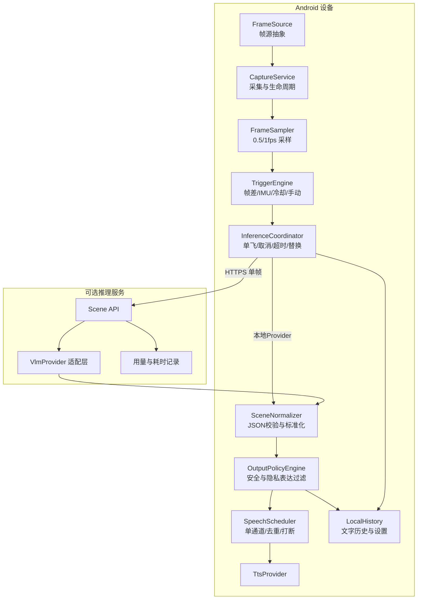

# Kanjian 系统架构设计 v1.1

- 版本：v1.1｜日期：2026-11-03｜状态：开发评审修订稿
- 上游：PRD v1.1｜下游：SDD v1.1、TDD v1.1
- 修订依据：`REVIEW_v1.md`；变更明细见 00 §9「修订记录」

## 1. 架构目标

1. 以最小云端依赖完成“帧采集—场景理解—安全过滤—语音描述”闭环。
2. 采样、推理和播报解耦，避免逐帧推理与连续播报造成成本、延迟和听觉负担失控。
3. 模型、语音和帧源可替换，核心安全策略不随提供方改变。
4. 云端故障、模型幻觉、输出格式错误均不能绕过本地输出策略。
5. 默认不留存原始图像，用户可验证云端关闭行为。
6. 保持模块边界，为未来授权分层和硬件适配保留空间。

## 2. 系统上下文

### 信任边界

- **设备可信区**：权限、帧筛选、任务调度、输出策略、历史删除、密钥保护。
- **项目服务区**：仅处理当前请求所需的帧与元数据，不建立用户画像。
- **第三方模型区**：按其服务条款处理数据；是否训练、保留多久必须单独记录。
- **不可信输入**：摄像头内容、模型输出、网络响应、外部贡献插件。模型输出永远不是可直接执行的指令。

## 3. 逻辑架构

## 4. 端云职责

| 能力 | 端侧 | 推理服务 | 第三方 Provider |
|---|---|---|---|
| 摄像头权限与帧生命周期 | 必须 | 无 | 无 |
| 采样、帧差、IMU、冷却 | 必须 | 无 | 无 |
| 手动询问与任务取消 | 必须 | 支持取消/超时 | 尽力而为 |
| 图像压缩与隐私提示 | 必须 | 复核 | 不承担项目责任 |
| 复杂场景理解 | 可选本地插件 | 编排 | 执行 |
| JSON Schema 校验 | 必须复核 | 必须 | 输出原始结果 |
| 行动指令/精确距离/身份识别阻断 | **最终防线** | 初筛 | 不作为依赖 |
| 去重、冷却、打断、停止 | 必须 | 无 | 无 |
| TTS | 默认 | 可选 | 可选 |
| 历史与删除 | 必须 | 默认不持久化 | 依其条款 |
| 成本估算 | 汇总展示 | 请求级记录 | 提供用量/单价配置 |

## 5. 核心数据流

### 5.1 主动询问

1. 用户触发询问，App 获取最新可用帧并标记 `origin=USER`。
2. 当前自动推理若可取消则取消；正在播放的自动描述按策略停止。
3. 图像在内存中缩放/压缩，生成一次性 `request_id`。
4. 推理协调器执行本地或云端 Provider；超时进入降级。
5. 网关与端侧分别校验结构；端侧执行最终输出策略。
6. 通过校验的短文本进入用户优先播报通道。
7. 保存文字与必要元数据，原图随请求结束释放。

### 5.2 自动观察

1. 按 0.5/1 fps 采样，不代表每帧上传。
2. TriggerEngine 计算画面变化、设备运动、距上次推理时间和场景相似度。
3. 未达阈值：丢帧；达到阈值：生成低优先级候选任务。
4. 单飞策略防止请求堆积；过期候选直接丢弃。
5. 新结果先与当前场景指纹比较，再决定是否值得播报。
6. 用户阅读或主动询问期间，自动描述不抢占语音。

### 5.3 无网或模型失败

- 不伪造描述；语音提示当前能力与重试方式。
- 若启用本地基础能力，只能输出其确实支持的有限信息，并明确“本地基础识别”。
- 没有可靠本地结果时，仅报告服务状态，不把“未识别”说成“没有物体”。

## 6. 关键架构决策（ADR）

### ADR-01：事件触发优于固定频率推理

- 状态：接受
- 原因：固定 1 fps 上云会持续产生费用和过期结果；语音也无法逐句消费。
- 后果：需要评测触发召回与延迟，不能只评测单帧描述质量。

### ADR-02：端侧拥有最终输出权

- 状态：接受
- 原因：云端提示词不能保证永远遵守安全边界。
- 后果：所有 Provider 必须返回结构化结果；自由文本需先解析或拒绝，不直接播报。

### ADR-03：默认设备 TTS

- 状态：接受
- 原因：减少云端语音成本与音频传输，便于即时停止。
- 后果：音色与自然度依赖设备；云端 TTS 只能作为可选 Provider。

### ADR-04：单飞推理 + 单条待播

- 状态：接受
- 原因：旧环境描述对新环境可能不但无用，还会误导。
- 后果：吞吐让位于新鲜度；必须暴露取消和丢弃指标。

### ADR-05：MVP 不引入账户与云数据库

- 状态：接受
- 原因：减少个人信息与运维复杂度。
- 后果：历史不跨设备同步；服务端横向扩展保持无状态。

### ADR-06：通过接口而非分支支持多 Provider

- 状态：接受
- 原因：保护核心代码与授权边界，避免每接入一个模型就复制一套流程。
- 后果：Provider 能力以声明式元数据暴露，不能假设均支持视频、流式或本地运行。

### ADR-07：MVP 不提供维护者付费的公开默认端点（R-03）

- 状态：接受（本版新增，解决 v1.0 的 §9.1 与 §11 矛盾）
- 背景：v1.0 §9.1 写"官方 App 连接项目网关"，§11 又写"不提供让普通用户无感知消耗维护者 API 额度的公开默认端点"。两句话未定义 MVP 的默认配置，导致"成本由谁承担"这一公益项目最关键的问题无答案。
- 决策：**MVP 发布形态不包含任何由维护者付费、默认指向的公共端点。** App 首次启动时云端能力处于"未配置"状态，用户必须显式完成以下之一才能启用云端：
  1. 填写自托管网关地址（形态 A）；
  2. 使用用户自有 API 端点与密钥（形态 B 的变体）；
  3. 保持云端关闭，仅使用手动 + 端侧能力（形态 C）。
- 后果：
  1. §9.1 的"官方 App 连接项目网关"**仅适用于内部开发与受邀试点环境**，不作为公开发行默认值；该表述在本版限定为"受控部署"。
  2. 不产生维护者承担的持续云成本，避免公益项目因个别用户滥用而不可持续。
  3. 首次说明（FR-ONB-001/002）必须明确"本应用不附带云端服务，需自行配置"。
  4. 若未来提供公共端点，须先完成预算上限（NFR-COST-002）、限流（NFR-COST-003）与滥用防护评审，并出新的 ADR 覆盖本条。

## 7. 状态与一致性

- 每个请求携带 `session_id`（随机、可重置）、`request_id`、`frame_timestamp` 和 `policy_version`。
- 端侧只接受当前活动 session 且未过期的结果；迟到响应直接丢弃。
- 设置变更（如关闭云端）立即使未发送任务失效；已发送任务结果不得播报。
- 历史记录与播报使用同一标准化文本，避免 UI 与语音表达不一致。
- 所有时间使用单调时钟计算耗时，墙钟仅用于展示。

## 8. 性能与容量设计

- App 同时最多一个活动推理；自动任务不排队，手动任务按明确规则抢占。
- 服务端单实例无状态，可水平扩展；以并发请求数、Provider 限流和超时为容量边界。
- 默认图像上限、请求体上限、响应长度上限均在 TDD 固化。
- 不用延长超时掩盖慢模型；超时后取消并反馈。
- 播放时长不参与“模型推理延迟”指标，单独统计。

## 9. 安全与隐私架构

1. API 密钥不打包进公开 APK；**受控部署（内部开发/受邀试点）可连接项目网关，公开发行版默认无端点，由用户自行配置（见 ADR-07）**。
2. 传输使用 HTTPS，证书错误不得忽略；不记录完整图像到日志。
3. 图像仅在内存和请求生命周期内存在；崩溃日志不得包含 base64 图像。
4. 本地历史可全部清除；卸载后无云端账户残留。
5. 第三方插件只能获取其声明能力所需数据，不提供默认后台权限。
6. 威胁模型覆盖：恶意模型输出、提示注入文字、伪造服务端响应、依赖投毒、图像日志泄漏、旧结果误播。

## 10. 可观测性

本地环形缓冲记录结构化事件：采样、触发、丢弃、请求、超时、解析失败、安全过滤、去重、打断、播放、错误。默认仅保留必要元数据，用户主动导出；导出前展示内容并允许取消。

指标至少包括：云端触发率、P50/P95 各阶段耗时、取消率、迟到响应率、Schema 失败率、安全过滤命中率、重复播报率、崩溃率与估算成本。

## 11. 部署形态

- **形态 A（自托管 / 公益社区部署）**：Android App + 用户或社区部署的推理网关 + 自托管/合规 VLM。**这是公开发行版的推荐形态，端点由用户或社区提供。**
- **形态 B（纯手动体验）**：App 仅在用户点击时调用用户配置的端点，无自动上云。
- **形态 C（离线实验）**：本地 Provider；能力不足时明确降级，不宣称与云端等效。

**公开发行版不含任何默认端点**（ADR-07）。内部开发与受邀试点可预置项目网关地址，但该构建不得作为公开发行包分发。

不提供一个让普通用户无感知消耗维护者 API 额度的公开默认端点。若未来提供，须先满足 NFR-COST-002/003 并出新的 ADR。

## 12. 架构验收条件

- 替换 VLM/TTS Provider 不需修改 Trigger、Policy、Speech 核心逻辑（FR-DEF-001）。
- 关闭云端后通过网络抓包验证无图像请求。
- 迟到响应、错误 JSON、提示注入、超长文本均不能绕过端侧策略。
- 连续运行期间推理与播报队列不增长。
- 任意时刻停止后无残留播报。
- 所有外部数据跨越信任边界均有记录与最小化说明。
- **公开发行包中不含任何预置的云端端点地址或维护者密钥（ADR-07）。**
